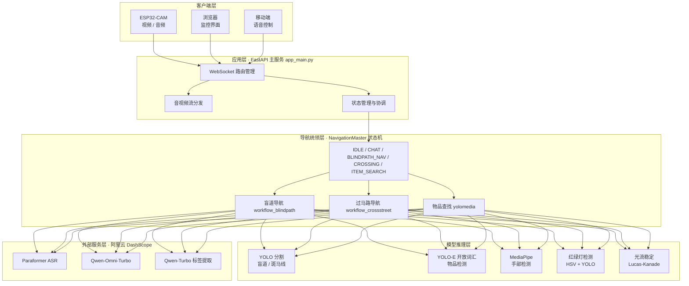

<div align="center">
  
</div>

<p align="center">
  
  
  
  
</p>

> **⚠️ 免责声明**：本项目仅为交流学习使用，请勿直接给视障人群使用。

---

## 📌 项目归属声明

本仓库由 **Charles (Zonkit)**（GitHub: [3072963Charles](https://github.com/3072963Charles)）独立整理、重构并发布，是本人 **"明眸 BrightEyes 智能导盲眼镜"** 项目的软件端。本仓库与 GitHub 上任何同名 / 相似的历史项目**相互独立、无隶属关系**，仓库地址以 `https://github.com/3072963Charles/OpenAIglasses_for_Navigation` 为准。代码中所有硬编码云服务凭据均已移除，统一改为从环境变量读取。

---

## 🎯 项目做了什么

一个面向视障人士的智能导航与辅助系统，集成 **盲道导航、过马路辅助、物品识别、实时语音交互** 四大能力，通过 WebSocket 连接 ESP32-CAM / 浏览器 / 移动端，形成端到端闭环。

| 功能模块 | 实现方案 |
|---------|---------|
| 🚶 盲道导航 | YOLO 分割实时识别盲道 + Lucas-Kanade 光流稳定掩码 + 转弯 / 避障引导 |
| 🚦 过马路辅助 | 斑马线检测 + HSV / YOLO 红绿灯识别 + 对齐引导 + 通行安全提醒 |
| 🔍 物品查找 | YOLO-E 开放词汇检测 + ByteTrack 追踪 + MediaPipe 手部引导 + 抓取确认 |
| 🎙️ 语音交互 | 阿里云 Paraformer 实时 ASR + Qwen-Omni-Turbo 多模态对话 + 智能指令解析 |
| 📹 视频处理 | WebSocket 实时视频流 + 音视频同步录制 + 多路音频混音 |
| 🎨 可视化 | Web 实时监控 + Three.js IMU 3D 姿态可视化 + 状态面板 |

---

## 🏗️ 系统架构



### 核心模块

| 模块 | 文件 | 功能 |
|------|------|------|
| 主应用 | `app_main.py` | FastAPI 服务、WebSocket 管理、状态协调 |
| 导航统领 | `navigation_master.py` | 状态机管理、模式切换、语音节流 |
| 盲道导航 | `workflow_blindpath.py` | 盲道检测、避障、转弯引导 |
| 过马路导航 | `workflow_crossstreet.py` | 斑马线检测、红绿灯识别、对齐引导 |
| 物品查找 | `yolomedia.py` | YOLO-E 开放词汇检测、手部引导、抓取确认 |
| 语音识别 | `asr_core.py` | Paraformer 实时 ASR |
| 多模态对话 | `omni_client.py` | Qwen-Omni-Turbo 对话客户端 |
| 音频播放 | `audio_player.py` | 多路音频混音与播放 |

---

## 🧑‍💻 我的工作

| 阶段 | 工作内容 |
|------|----------|
| 🏛️ 架构设计 | 软硬件分层架构 + 导航状态机（NavigationMaster）设计 |
| 🖥️ 软件端 | FastAPI 后端服务、WebSocket 音视频流、AI 算法集成（YOLO / YOLO-E / MediaPipe / 光流） |
| 🔌 算法集成 | 盲道分割、红绿灯识别、开放词汇检测、手部引导、抓取确认的工程化实现 |
| 🎙️ 语音链路 | Paraformer ASR + Qwen-Omni 多模态对话的接入与节流策略 |
| 🧪 系统联调 | 软硬件联调、实机验证、性能调优 |

**🧭 工作领域**：AIoT 智能硬件 · 计算机视觉 · 实时音视频 · 语音交互

---

## 🎓 学到了什么

| 方向 | 收获 |
|------|------|
| 目标检测与分割 | YOLO 实例分割、YOLO-E 开放词汇检测、红绿灯 HSV + YOLO 融合识别 |
| 多目标追踪 | ByteTrack 追踪算法与工程集成 |
| 光流算法 | Lucas-Kanade 光流用于掩码稳定与抗抖动 |
| 状态机架构 | 多模式导航状态机（IDLE / CHAT / BLINDPATH_NAV / CROSSING / ITEM_SEARCH）设计与模式切换 |
| 后端工程 | FastAPI + WebSocket 实时流、多客户端并发、音视频同步录制与混音 |
| 多模态 AI | Paraformer 实时 ASR、Qwen-Omni 图文语音多模态对话的 API 工程化 |

---

## 🧰 工具链

<p align="center">
  
  
  
  
  
  
  
  
</p>

---

## 🏆 主要成果

- 🏅 **中国高校计算机大赛 海南省二等奖**
- 🤖 完整可运行的**软硬件一体化**智能导盲原型（软件端 + STM32 硬件端）
- 🎙️ 支持 4 大功能闭环：盲道导航 / 过马路辅助 / 物品查找 / 实时语音交互
- 📡 Web 实时监控 + IMU 3D 姿态可视化

---

## 💻 系统要求

| 类别 | 要求 |
|------|------|
| CPU / GPU | Intel i5+（推荐 i7/i9）· NVIDIA GPU（CUDA 11.8+，推荐 RTX 3060+） |
| 内存 / 存储 | 8GB（推荐 16GB）· 10GB 可用空间 |
| 系统 | Windows 10/11 · Ubuntu 20.04+ · macOS 10.15+ |
| Python / CUDA | Python 3.9–3.11 · CUDA 11.8+ |
| API 密钥 | 阿里云 DashScope API Key（[申请地址](https://dashscope.console.aliyun.com/)） |

---

## 🚀 快速开始

### 1. 克隆项目

```bash
git clone https://github.com/3072963Charles/OpenAIglasses_for_Navigation.git
cd aiglass/rebuild1002
```

### 2. 安装依赖

```bash
python -m venv venv
# Windows
venv\Scripts\activate
# Linux/macOS
source venv/bin/activate
pip install -r requirements.txt
```

### 3. 下载模型文件

将以下模型文件放入 `model/` 目录：

| 模型文件 | 用途 | 大小 |
|---------|------|------|
| `yolo-seg.pt` | 盲道分割 | ~50MB |
| `yoloe-11l-seg.pt` | 开放词汇检测 | ~80MB |
| `shoppingbest5.pt` | 物品识别 | ~30MB |
| `trafficlight.pt` | 红绿灯检测 | ~20MB |
| `hand_landmarker.task` | 手部检测 | ~15MB（[MediaPipe Models](https://developers.google.com/mediapipe/solutions/vision/hand_landmarker#models)） |

### 4. 配置 API 密钥

创建 `.env` 文件（凭据不写入代码）：

```bash
# .env
DASHSCOPE_API_KEY=your_api_key_here
```

### 5. 启动系统

```bash
python app_main.py
```

系统将在 `http://0.0.0.0:8081` 启动，打开浏览器访问实时监控界面。

### 6. 连接设备（可选）

1. 烧录 `compile/compile.ino` 到 ESP32-CAM
2. 修改 WiFi 配置，连接到同一网络
3. ESP32 自动连接到 WebSocket 端点

---

## 📄 许可证

本项目采用 MIT 许可证 - 详见 [LICENSE](LICENSE) 文件

---

*Author: Charles (Zonkit) · 明眸 BrightEyes 智能导盲眼镜 · 软件端*
