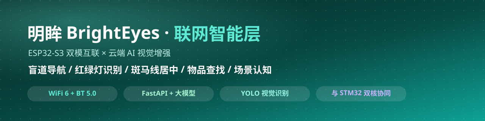
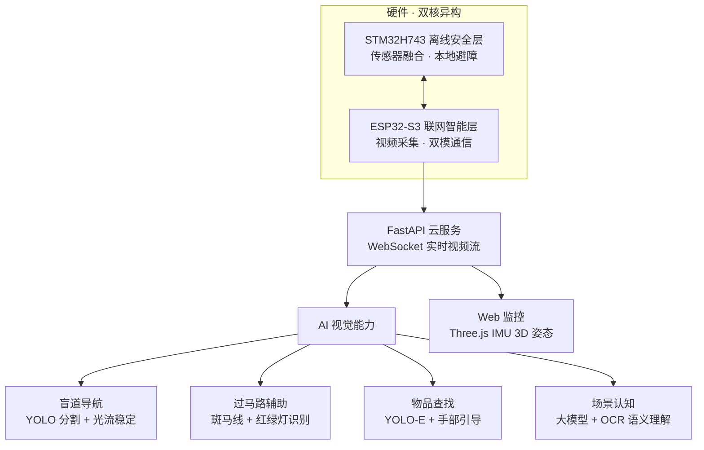

<div align="center">
  
</div>

<p align="center">
  
  
  
  
  
</p>

> **⚠️ 免责声明**：本项目仅为交流学习使用，请勿直接给视障人群使用。

---

## 📌 项目归属声明

本仓库由 **Charles (Zonkit)**（GitHub: [3072963Charles](https://github.com/3072963Charles)）独立整理、重构并发布，是本人 **"明眸 BrightEyes 智能导盲眼镜"** 项目的**联网智能层**。本仓库与 GitHub 上任何同名 / 相似的历史项目**相互独立、无隶属关系**，仓库地址以 `https://github.com/3072963Charles/OpenAIglasses_for_Navigation` 为准。代码中所有硬编码云服务凭据均已移除，统一改为从环境变量读取。

---

## 📌 项目定位

**明眸 BrightEyes AI 全域智能导盲眼镜**的**联网智能层**：以 **ESP32-S3** 为通信与采集核心（WiFi 6 + BT 5.0 双模互联、视频采集），接入**云端 AI 视觉服务**（FastAPI），在离线安全层保障基础安全的前提下，实现从"感知障碍物"到"理解环境"的跨越——**盲道高精度导航、红绿灯状态识别、斑马线居中引导、生活物品查找跟随、AI 场景认知**。

## 🔗 双核协同（本仓库在双模架构中的位置）

本仓库是明眸 BrightEyes **双核异构架构**（STM32H743 主控 + ESP32-S3 通信）的**联网智能层**，与 [离线安全层（blindglasses-stm32）](https://github.com/3072963Charles/blindglasses-stm32) 协同工作、不可分割：

| 层级 | 主控 | 职责 | 运行方式 |
|------|------|------|----------|
| ⚡ **离线安全层** | STM32H743 | 传感器感知 · 避障决策 · 语音预警 · 跌倒检测 | 本地闭环 · 始终在线 · 无需网络 |
| 🌐 **联网智能层（本仓库）** | ESP32-S3 | 视频采集 · 云端 AI 视觉理解 · 场景认知 | 连接手机网络时激活 |



---

## 🎯 核心能力（联网 AI 增强）

### 🚶 盲道导航系统
- 盲道识别：YOLO 分割精准定位盲道、判断前进方向
- 语音导航：播报直行 / 左转 / 右转，实时带路
- 实时避障：侦测前路障碍物，自动规划绕行路线
- 弯道提醒：提前识别盲道急弯，语音提醒减速
- 画面防抖：Lucas-Kanade 光流算法减弱走路抖动，保障识别稳定

### 🚦 过马路辅助
- 斑马线定位：实时识别斑马线方位与走向
- 红绿灯辨识：颜色 + 形态判断信号灯状态
- 居中引导：语音指引走到斑马线中间
- 通行提醒：绿灯播报，提示安全过马路

### 🔍 物品识别与查找
- 语音找物：喊话下达指令，一键搜寻指定物件
- 目标跟随：AI 识别锁定物品并持续追踪
- 手势引路：MediaPipe 识别手部位置，指引手伸向目标
- 抓取核验：检测握取动作，确认拿取成功
- 多方式提示：画面标位 + 语音播报辅助对准

### 🧠 AI 场景认知（不只是看见，而是理解环境）
- 全维环境语义理解：识别公交站、电梯、商店等场景
- OCR 文字解析：读取路牌、门牌，生成自然语言描述
- 多模态融合：视觉大模型 + OCR + 语义生成
- 指标：复杂场景识别 **95%+** · OCR 解析率 **98%** · 关键环境信息覆盖 **100%**

### 📱 Web 监控与可视化
- 实时视频流：WebSocket 推流，多客户端同时观看
- IMU 3D 可视化：Three.js 实时渲染设备姿态
- 状态面板：导航状态、检测信息、FPS

---

## 🧑‍💻 我的工作

| 阶段 | 工作内容 |
|------|----------|
| 🏗️ 架构设计 | 双模系统中联网智能层的方案设计（ESP32-S3 采集 + 云端 AI 服务） |
| 🖥️ 后端服务 | FastAPI 云服务：WebSocket 实时音视频流、状态管理与协调 |
| 🤖 AI 集成 | 盲道分割、红绿灯识别、斑马线居中、物品查找、场景认知的工程化实现 |
| 🎙️ 语音链路 | 语音交互（ASR + 多模态对话）接入与指令解析 |
| 🔗 双核联调 | 与 STM32H743 离线安全层协同联调，实机场景验证 |

**🧭 工作领域**：AIoT 智能硬件 · 计算机视觉 · 实时音视频 · 云端 AI 服务

---

## 🎓 学到了什么

| 方向 | 收获 |
|------|------|
| 嵌入式通信 | ESP32-S3 双模互联（WiFi 6 + BT 5.0）、视频采集与 WebSocket 传输 |
| 目标检测 | YOLO 实例分割、YOLO-E 开放词汇检测、红绿灯 HSV + YOLO 融合识别 |
| 追踪与稳定 | ByteTrack 多目标追踪、Lucas-Kanade 光流抗抖动 |
| 多模态 AI | Paraformer 实时 ASR、Qwen-Omni 多模态对话、OCR + 语义生成的场景认知 |
| 后端工程 | FastAPI + WebSocket 实时流、多客户端并发、音视频录制与混音 |

---

## 🧰 工具链

<p align="center">
  
  
  
  
  
  
  
  
</p>

---

## 🏆 主要成果

- 🌐 **联网 AI 增强层**：让导盲眼镜从"安全出行"升级为"智慧出行"
- 🧠 **AI 场景认知**：环境语义理解 + OCR，构建"看见并理解世界"的能力
- 🔗 与 STM32H743 离线安全层组成**双模架构**，获中国高校计算机大赛 **海南省二等奖**
- 📡 Web 实时监控 + IMU 3D 姿态可视化

---

## 💻 系统要求

| 类别 | 要求 |
|------|------|
| CPU / GPU | Intel i5+（推荐 i7/i9）· NVIDIA GPU（CUDA 11.8+，推荐 RTX 3060+） |
| 内存 / 存储 | 8GB（推荐 16GB）· 10GB 可用空间 |
| 系统 | Windows 10/11 · Ubuntu 20.04+ · macOS 10.15+ |
| Python / CUDA | Python 3.9–3.11 · CUDA 11.8+ |
| API 密钥 | 阿里云 DashScope API Key（[申请地址](https://dashscope.console.aliyun.com/)） |

---

## 🚀 快速开始

### 1. 克隆项目

```bash
git clone https://github.com/3072963Charles/OpenAIglasses_for_Navigation.git
cd aiglass/rebuild1002
```

### 2. 安装依赖

```bash
python -m venv venv
# Windows
venv\Scripts\activate
# Linux/macOS
source venv/bin/activate
pip install -r requirements.txt
```

### 3. 下载模型文件

将以下模型文件放入 `model/` 目录：

| 模型文件 | 用途 | 大小 |
|---------|------|------|
| `yolo-seg.pt` | 盲道分割 | ~50MB |
| `yoloe-11l-seg.pt` | 开放词汇检测 | ~80MB |
| `shoppingbest5.pt` | 物品识别 | ~30MB |
| `trafficlight.pt` | 红绿灯检测 | ~20MB |
| `hand_landmarker.task` | 手部检测 | ~15MB（[MediaPipe Models](https://developers.google.com/mediapipe/solutions/vision/hand_landmarker#models)） |

### 4. 配置 API 密钥

创建 `.env` 文件（凭据不写入代码）：

```bash
# .env
DASHSCOPE_API_KEY=your_api_key_here
```

### 5. 启动系统

```bash
python app_main.py
```

系统将在 `http://0.0.0.0:8081` 启动，打开浏览器访问实时监控界面。

### 6. 连接设备（可选）

1. 烧录 `compile/compile.ino` 到 ESP32-S3
2. 修改 WiFi 配置，连接到同一网络
3. ESP32 自动连接到 WebSocket 端点

---

## 📄 许可证

本项目采用 MIT 许可证 - 详见 [LICENSE](LICENSE) 文件

---

*Author: Charles (Zonkit) · 明眸 BrightEyes 智能导盲眼镜 · 联网智能层（ESP32-S3 × 云端 AI）*
